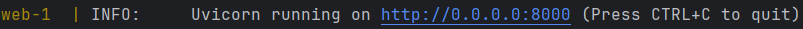
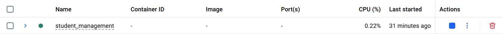

### 📚 STUDENT MANAGEMENT
Basic RESTful API project built with **FastAPI**, integrated with a **PostgreSQL** database, and fully containerized using **Docker**.

## 🛠 Tech Stack
| Công nghệ | Vai trò                                  | Phiên bản |
| :--- |:-----------------------------------------| :--- |
| **FastAPI** | Web Framework                            | 0.110.x |
| **PostgreSQL** | Database                                 | 15 |
| **SQLAlchemy** | ORM                                      | 2.0.x |
| **Alembic** | Database Migration                       | 1.13.x |
| **Uvicorn** | ASGI Server                              | 0.27.x |
| **Docker** | Containerization     | 20.x+ |

## 🛠 Prerequisites
Before running the project, ensure you have the following installed:

*   **Docker Desktop**: [Download and Install Docker](https://docker.com) (Required to run the application and database).
*   **Git**: [Download Git](https://git-scm.com) (To clone the repository).

## 🚀 Installation & Setup
### Step 1: Clone project
```bash
git clone https://github.com/htkhoaa/student-management.git
```
### Step 2: Spin up the Environment with Docker
Use Docker Compose to automatically pull the database image and build the FastAPI application
```bash
docker-compose up --build
```
*Verification:*
- Wait until the terminal displays: `Uvicorn running on http://0.0.0` as shown below:
 
- You should see the student_management stack running in your Docker Desktop as shown below:
 

### Step 3: Access the Application
*   **Base Url:** [http://localhost:8000](http://localhost:8000)
*   **API Docs (Swagger):** [http://localhost:8000/docs](http://localhost:8000/docs)

## 📂 Project Structure
*  📁 `migrations/`: Database version control
*  📄 `main.py`: The entry point of the application.
*  🐳 `docker-compose.yml`: Configuration for App and Database services.
*  🏗️ `requirements.txt`: Python dependencies.
*  📋 `Dockerfile`: Build instructions for the Docker image.

## 📝 Database Configuration
- User: `user`
- Password: `1234`
- DB: `student_management`
- Port: `5432`
## 🛑 Stopping the Application
- To stop the services, press `Ctrl + C`
  - To start again, only run `docker-compose up`
- To shut down and remove containers, run:
```bash
docker-compose down
```